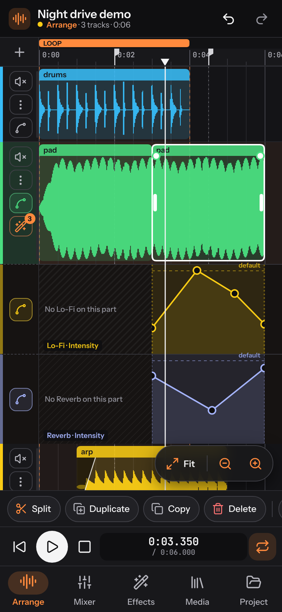
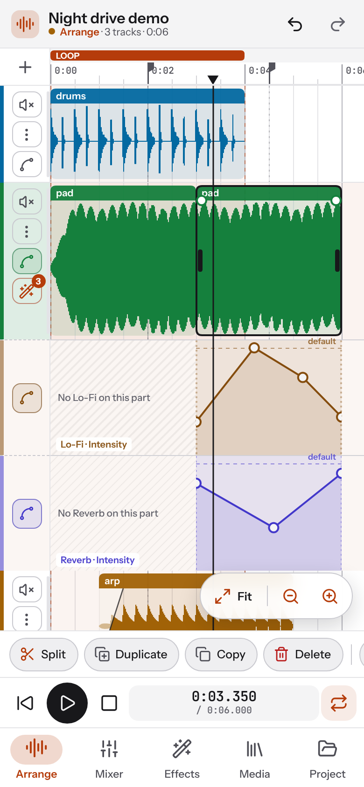
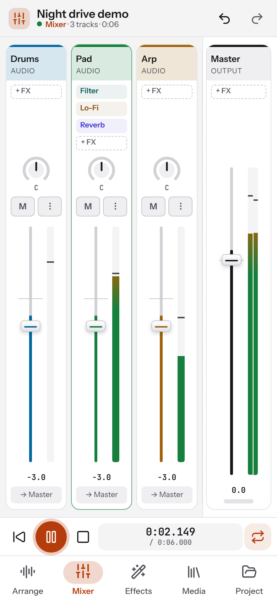
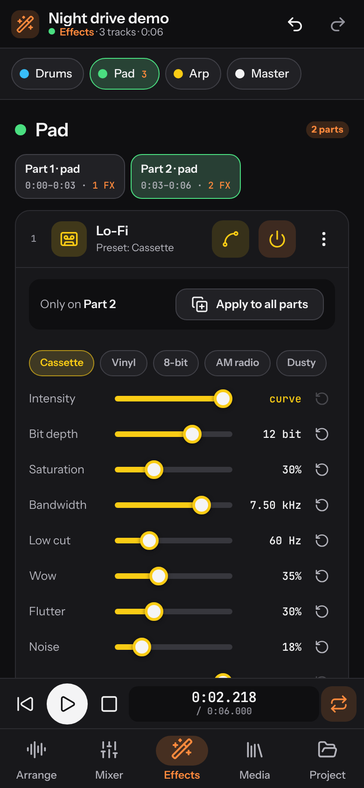
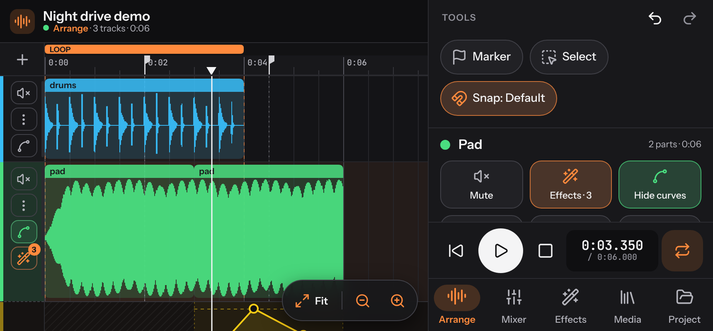

# SnapWav

A lightweight, touch-first multitrack audio workstation for Android and the web. Arrange your own audio files, give every part its own effects, shape them with volume, pan and intensity curves, and export WAV or MP3.

**[Download for Android](../../releases/latest)** · **[Open the web app](https://jeswinjosu.github.io/snapwav/)**

Inspired by [yadaw](https://github.com/mlm-games/yadaw), rebuilt from scratch for phones: the navigation sits at the bottom within thumb reach, the interface uses one orange palette taken from the logo in a dark and a light theme, each track keeps its own identifying colour, and the Android app is about 400 KB and works offline.

| Arrange (dark) | Arrange (light) | Mixer (light) | Effects (dark) |
|:-:|:-:|:-:|:-:|
|  |  |  |  |

In landscape the tracks take the left side and the tools, track options (as tiles), transport and navigation move to a panel on the right:



## Features

- **Arrange** – waveform timeline in minutes and seconds; drag clips (also between tracks), trim edges, fade handles, split, duplicate, copy/cut/paste, reverse, normalize, clip gain, varispeed, loop region, pinch-zoom and momentum scrolling. Fit, zoom out and zoom in sit in a floating pill above the toolbar; hold a zoom button to keep zooming.
- **Tracks** – compact headers with mute, options (three-dot menu), curves and effects icons (as many as the track height allows); *Add track* imports a new track, adds one from the session's media, or adds an empty track. To hear one track on its own, mute the others.
- **Snap** – *Default* snaps clips to other clips, markers, the loop and the playhead; *Beats* snaps to a beat grid (1/16 to a bar, with its own tempo); *Off* moves freely.
- **Markers** – one tap on *Marker* drops a marker at the playhead; when the playhead is within 100 ms of a marker the same button removes it.
- **Parts** – split a track into parts; each part has its own effect chain, volume and pan. *Apply to all parts* copies an effect across the track and can keep the copies in sync.
- **Curves** – lanes for track volume/pan, part volume/pan and the intensity (wet/dry) of each effect, drawn in that effect's colour. A dashed line shows the default value and points snap to it.
- **Effects** – Reverb, Delay (ping-pong, free or synced to the Beats tempo), Lo-Fi, EQ, Compressor, Filter (with LFO), Distortion and Chorus, each with presets and its own colour. Select a part in Arrange and open *Effects* to edit that part. Every slider has a reset button, and reverb and delay tails stop when you pause. Save a part's whole effect chain as a named preset and apply it to other parts or tracks.
- **Mixer** – faders with peak meters, pan, mute, track menu and a master strip with clip indicator.
- **Media** – import WAV, MP3, OGG, FLAC, M4A, AAC and Opus; preview; see which tracks use each file.
- **Project** – several sessions saved on your device, undo/redo, autosave, export the mix or stems as WAV (16/24/32-bit float) or MP3 (128–320 kbps) with **?** tips that explain bit depth and sample rate and estimate the file size, session archives (`.snapwav.zip`) and [DAWproject](https://github.com/bitwig/dawproject) import/export.
- **Layouts** – portrait with the tools, transport and navigation at the bottom; landscape with the tracks on the left and a side panel on the right. Menus slide up from the bottom and close by dragging their holding bar down.
- **Appearance** – dark and light themes (or follow the phone). Both themes meet WCAG 2.2 AA contrast.
- **Android** – runs offline; *Share → SnapWav* and *Open with SnapWav* for audio files; system *Save to…* picker for exports; Back button closes menus first; screen stays on during playback; haptics.

No bundled sounds and no MIDI: SnapWav works on audio you bring.

## Install

**Android 7.0 or newer.** Download the latest `snapwav-<version>.apk` from [Releases](../../releases/latest), open it, and allow installs from your browser or file manager when Android asks. New versions install over the old one and keep your sessions. Keep *Android System WebView* up to date from the Play Store; SnapWav runs on it.

**Web app.** Open [SnapWav in your browser](https://jeswinjosu.github.io/snapwav/). In Chrome on Android choose *⋮ → Install app* to add it to your home screen; it then works offline and shows up in the Share menu.

Your sessions and audio stay on your device; nothing is uploaded. Use *Project → Export session archive* to back up a session or move it to another device.

## Build from source

### Web app

```sh
cd web
npm ci            # optional: esbuild minifier and the Lucide icon set
python3 build.py  # Python 3.8+
npm run serve     # http://localhost:8000
```

`build.py` writes the installable web app to `web/dist/pwa/` and refreshes the Android app's assets in `android/app/src/main/assets/www/`. Without `npm ci` it still builds, unminified, using the icons in `web/vendor/lucide/`.

### Android APK

With Android Studio, open the `android/` folder and press Run. From the command line (JDK 17 and the Android SDK):

```sh
python3 web/build.py          # whenever the web app changed
cd android
./gradlew assembleDebug        # → app/build/outputs/apk/debug/app-debug.apk
```

To sign a release build with your own key, set `SNAPWAV_KEYSTORE`, `SNAPWAV_KEY_ALIAS`, `SNAPWAV_KEYSTORE_PASSWORD` and `SNAPWAV_KEY_PASSWORD` and run `./gradlew assembleRelease`. `android/build-without-gradle.sh` builds the same APK with only the command-line Android tools, without Gradle or Android Studio.

## Project layout

```
web/
  src/            style.css, body.html and js/ modules (joined in name order)
  icons/          app icons for the web app
  vendor/         Lucide icons, fonts, lamejs (MP3 encoder) with their licenses
  build.py        builds dist/pwa and the Android assets
android/
  app/src/main/   AndroidManifest.xml, MainActivity.java, res/, assets/www (generated by build.py)
  build-without-gradle.sh
docs/screenshots/
```

## How it works

- **Audio engine** – Web Audio API. Each part runs through its own chain (part effects → part volume → part pan), then the track chain (phase → track effects → fader → pan → mute), then the master bus. Every effect sits inside a wet/dry crossfade, which is what the intensity curves drive. Curves are scheduled as parameter ramps, and exports render the same graph in an `OfflineAudioContext`.
- **Android app** – a single `WebView` loads the bundled web app straight from the APK, so nothing is fetched from the network. A small bridge adds what a browser can't do inside an app: saving exports through the system picker, receiving shared or opened files, keeping the screen on and haptics.

## License

SnapWav is free software: you can redistribute it and/or modify it under the terms of the [GNU Affero General Public License v3.0](LICENSE).

Third-party components and their licenses are listed in [THIRD_PARTY_NOTICES.md](THIRD_PARTY_NOTICES.md). SnapWav is an independent implementation inspired by yadaw and contains no yadaw code.

[web]: https://YOUR-USERNAME.github.io/YOUR-REPO/
